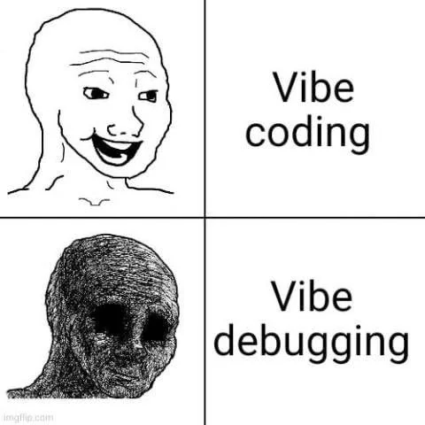
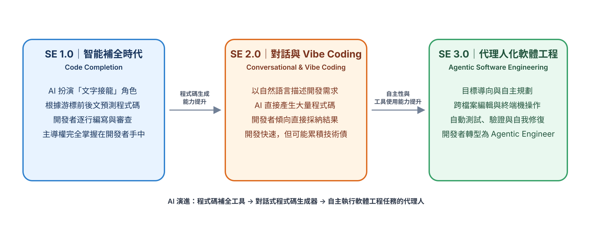
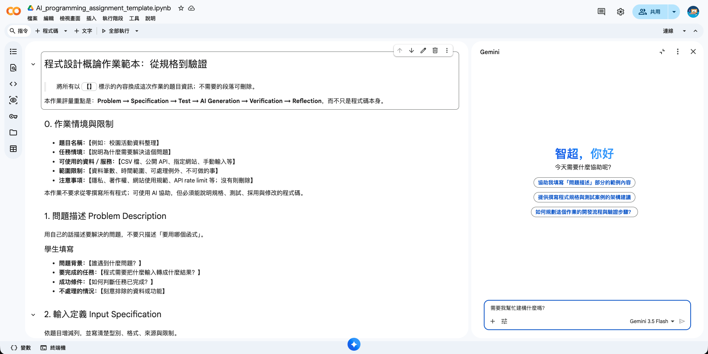
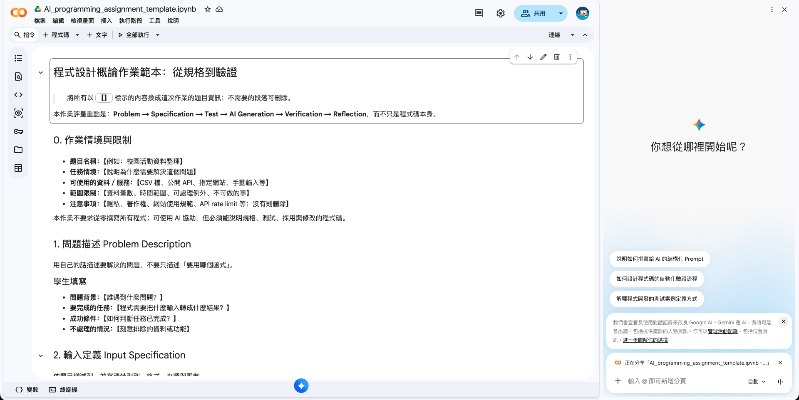

<!-- _class: cover -->

# AI Coding

許智超

<cchsu@mail.nsysu.edu.tw>

---

<!-- _class: section-page -->

## AI Coding

---

<!-- _class: lead -->

### AI 這麼厲害，我還要學 Coding 嗎？


---

<!-- _class: lead -->

### 我是不是可以 Vibe Coding 就好？



---

### Vibe Coding 的隱憂

- **看起來能跑，不代表正確**：沒有驗證，錯誤藏在邊界情況
- **看不懂、改不動**：程式碼不是自己的，出錯無從除錯
- **越改越亂**：對話一長，AI 忘記前面的決定，改一處壞三處
- **安全與品質風險**：金鑰外洩、漏洞、相依套件問題難以察覺
- **無法重現與維護**：同樣的 Prompt 得到不同結果，意圖沒有記錄

> 適合：原型、一次性小工具　不適合：要長期維護的系統

---

### 用軟體工程解決 Vibe Coding 的問題

| Vibe Coding 的隱憂 | 軟體工程的解法 |
|---|---|
| 看起來能跑，不代表正確 | **測試**：TDD、自動化測試 |
| 看不懂、改不動 | **程式碼審查**、模組化、文件 |
| 越改越亂 | **版本控制**（Git）、小步提交 |
| 安全與品質風險 | 安全檢查、相依套件掃描、CI |
| 無法重現與維護 | **規格先行**：SDD、BDD |

> AI 負責寫得快，軟體工程負責做得對

---

<style scoped>
p { text-align: center; }
</style>

### 軟體工程（SE）與 AI 結合的演進階段



---

### SDD：Spec-Driven Development

- 先寫**規格**，再讓 AI 實作
- 規格 = 需求 + 限制 + 驗收標準
- 人定義「做什麼」，AI 負責「怎麼做」

---

### SDD 的流程

1. **Specify**：描述要做什麼、為什麼做
2. **Plan**：決定技術選型與架構
3. **Tasks**：拆成小而可驗證的任務
4. **Implement**：AI 實作，人審查

---

### 為什麼 AI Coding 需要 SDD？

| Vibe Coding 的問題 | SDD 的解法 |
|---|---|
| Prompt 含糊，AI 只能猜 | 規格明確 |
| 對話一長，AI 忘記決定 | 規格存成檔案，隨時重載 |
| 改一處壞三處 | 驗收標準可驗證 |
| 結果不一致、難維護 | 意圖有文件、可追溯 |

> AI 寫得很快，瓶頸變成「說清楚要什麼」

---

### AI 目前使用 SDD 的問題

- **規格仍是自然語言**：模糊、遺漏處 AI 照樣用猜的
- **AI 不一定照規格做**：漏掉條件、擅自增加未定義的功能
- **規格與程式漂移**：程式一改，規格沒同步，文件變成過期資料
- **規格寫得對，不代表程式對**：缺少客觀驗證，AI 仍可能宣稱「完成了」

> SDD 說清楚「做什麼」，但還需要 BDD、TDD 驗證「做對沒」

---

### BDD：Behavior-Driven Development

- 用**行為**描述需求，再驅動開發與測試
- 用 Given / When / Then 寫成人人看得懂的情境
- 同一份情境，既是需求，也是自動化測試

---

### BDD 的流程：Discover → Formulate → Automate

1. **Discover**：和使用者、團隊討論，找出具體範例
2. **Formulate**：把範例寫成 Given / When / Then
3. **Automate**：情境變成自動化測試，AI 負責讓它通過

工具：Cucumber、Behave、pytest-bdd

---

### 為什麼 AI Coding 需要 BDD？

| AI Coding 的問題 | BDD 的解法 |
|---|---|
| 需求用自然語言，AI 誤解 | 具體情境，沒有模糊空間 |
| 人看不懂測試程式碼 | 情境用白話寫，人可直接審查 |
| 需求和測試脫節 | 情境本身就是可執行的測試 |
| AI 自己宣稱「完成了」 | 情境通過才算完成 |

> SDD 管「做什麼」，BDD 把它寫成行為，TDD 管「做對沒」

---

<style scoped>
section p, li, pre { font-size: 0.9em; }
</style>

### 行為怎麼寫？Given / When / Then

- **Feature**：功能
    - **Scenario**：場景
        - **Given**：前提，目前的狀態
        - **When**：當發生什麼動作
        - **Then**：預期的結果

```gherkin
Feature: 購物車結帳
    Scenario: 已登入的使用者結帳
        Given 使用者已登入，購物車有 2 件商品
        When  使用者按下「結帳」
        Then  顯示訂單總額，並建立一筆待付款訂單
```

一條需求就是一個可驗證的情境，也能直接轉成測試

---

### TDD：Test-Driven Development

- 先寫**測試**，再寫程式
- 測試 = 可執行的規格
- 人定義「什麼叫做對」，AI 負責讓測試通過

---

### TDD 的流程：Red → Green → Refactor

1. **Red**：先寫一個會失敗的測試
2. **Green**：寫最少的程式讓測試通過
3. **Refactor**：在測試保護下重構

重複循環，每次只前進一小步

---

### 為什麼 AI Coding 需要 TDD？

| AI Coding 的問題 | TDD 的解法 |
|---|---|
| AI 看起來對，其實有錯 | 測試客觀判定對錯 |
| 看不懂每一行程式碼 | 只需審查測試與結果 |
| 改一處壞三處 | 回歸測試立即發現 |
| AI 自己宣稱「完成了」 | 測試通過才算完成 |

> SDD 管「做什麼」，BDD 寫成行為，TDD 管「做對沒」

---

<!-- _class: lead -->

### 測試案例，是 AI Coding 最重要的一份文件

**沒有測試案例，你就無法判斷 AI 寫的程式是否正確**

---

### assert：最簡單的自動化測試

- 語法：`assert 條件, "失敗時的訊息"`
- 條件為 `True` → 什麼都不發生，測試通過
- 條件為 `False` → 丟出 `AssertionError`，測試失敗

```python
def add(a, b):
    return a + b

assert add(1, 2) == 3                 # 通過，沒有任何輸出
assert add(-1, 1) == 0, "負數相加錯誤"  # 通過
assert add(2, 2) == 5, "2 + 2 應該是 4"  # AssertionError: 2 + 2 應該是 4
```

浮點數用 `abs(a - b) < 0.01` 或 `round()` 比較，不要直接用 `==`

---

### 如何撰寫好的測試案例

- **正常情況**：最常見、預期的輸入
- **邊界情況**：空資料、最小／最大值、只有一筆
- **異常情況**：缺欄位、格式錯誤、找不到資源
- **先寫測試，再請 AI 實作**，不要讓 AI 自己出題自己考
- 測試要**具體、可重現**：明確的輸入與預期結果

```python
def test_empty_input():
    assert process_data([]) == []   # 邊界：空資料
```

---

### 實作流程

**Problem → Specification → Test → AI Generation → Verification → Reflection**

- 重點不只是程式碼本身
- 你要能說明規格、測試、採用與修改的程式碼

範本：[ai-coding-template.ipynb](https://colab.research.google.com/drive/1cSueDVBDfg9eGjyGjGOw5P8wjIzs08BH)

---

<style scoped>
p { text-align: center; }
</style>

### 在 Colab 中，我如何和 AI 協作？



---

<style scoped>
p { text-align: center; }
</style>

### 在 Colab 中，我如何和 AI 協作？



---

### HW07 BMI 計算器（BDD Ver.）

**唯一要求「手搓」的作業😉，請繳交手寫相片。**`.ipynb` 檔案另外上傳。

- **題目名稱**：BMI 計算器
- **任務情境**：健康中心要計算學生的身體質量指數，並判斷體位
- **可使用的資料**：手動輸入身高 cm、體重 kg
- **範圍限制**：只處理成人標準；不做飲食或醫療建議
- **注意事項**：使用 assert 自動化測試

---

<!-- _class: section-page -->

## Crawler & LLM with AI

---

### 什麼是網路爬蟲（Web Crawler）？

- **定義**：用程式自動瀏覽網頁、擷取需要的資料
- **人工 vs. 爬蟲**：人工要一頁頁點開、複製貼上；爬蟲幾秒鐘就能整理成表格
- **常見用途**：比價、新聞彙整、輿情分析、收集研究資料
- **本質**：模擬瀏覽器向伺服器「要網頁」，再從 HTML 中「挑出資料」

> 爬蟲禮儀：先看網站規範與 `robots.txt`；請求之間要間隔；不抓個資；不轉載或商業使用

---

### 網頁的組成：HTML

- 瀏覽器收到的是 **HTML**：由標籤（tag）組成的文字
- 資料藏在標籤裡，用 **標籤名稱**、`class`、`id` 來定位
- 在瀏覽器按 **F12**（或右鍵 →「檢查」）找到資料所在的標籤

```html
<div class="r-ent">
  <div class="title">
    <a href="/bbs/movie/M.1732500000.A.123.html">[討論] 這部電影好看嗎</a>
  </div>
  <div class="date">11/25</div>
  <div class="author">user123</div>
</div>
```

---

### 如何爬蟲：四個步驟

1. **觀察網頁**：用 F12 找出資料所在的標籤與 `class`
2. **發送請求**：用 `requests` 取得網頁 HTML
3. **解析資料**：用 `BeautifulSoup` 依標籤挑出需要的內容
4. **整理儲存**：用 `pandas` 整理成表格，存成 CSV

| 套件 | 用途 |
| --- | --- |
| `requests` | 向網站要網頁 |
| `BeautifulSoup` | 從 HTML 找資料 |
| `pandas` | 整理成表格 |

---

### 範例：抓取 PTT 電影版一頁標題

```python
import requests
from bs4 import BeautifulSoup
import pandas as pd

url = "https://www.ptt.cc/bbs/movie/index.html"
res = requests.get(url, headers={"User-Agent": "Mozilla/5.0"})  # 2. 發送請求
soup = BeautifulSoup(res.text, "html.parser")                   # 3. 解析 HTML

rows = []
for item in soup.select("div.r-ent"):
    a = item.select_one("div.title a")
    if a is None:                      # 文章已被刪除，沒有連結
        continue
    rows.append({"標題": a.text.strip(),
                 "日期": item.select_one("div.date").text.strip(),
                 "網址": "https://www.ptt.cc" + a["href"]})

df = pd.DataFrame(rows)                                         # 4. 整理成表格
df
```

---

### 爬更多頁、抓內文

- **上一頁**：找到「‹ 上頁」按鈕的連結，重複同樣步驟
- **文章內文**：進入每篇文章網址，抓 `div#main-content`
- **每次請求之間** `time.sleep(1)`，避免造成網站負擔
- **例外處理**：被刪除的文章、連線失敗，都要能略過而不中斷

```python
import time

prev = soup.select_one("a.btn.wide:-soup-contains('上頁')")
next_url = "https://www.ptt.cc" + prev["href"]
time.sleep(1)    # 禮貌間隔
```


---

### HW08 爬取 PTT 電影版

- **題目名稱**：爬取 PTT 電影版最新討論
- **任務情境**：想知道最近大家在 PTT 電影版討論什麼電影，但人工逐頁瀏覽、整理很花時間；請寫程式自動擷取最新文章，整理成表格方便快速瀏覽
- **可使用的資料**：PTT 電影版公開頁面 `https://www.ptt.cc/bbs/movie/index.html`
- **範圍限制**：抓 5 頁文章列表及列表文章內文；不需要登入
- **輸出要求**：存成 pandas `DataFrame`，欄位：標題、作者、日期、網址、內文；用 `df.head()` 顯示前幾筆，並存成 `ptt_movie.csv` 供 HW09、HW10 使用
- **注意事項**：遵守網站使用規範；每次請求間隔至少 1 秒，避免短時間重複執行；只供課堂學習，不可轉載或商業使用

本作業不要求從零撰寫所有程式；可使用 AI 協助，但必須能說明規格、測試、採用與修改的程式碼


---

### 用大型語言模型（LLM）協助分析文本

- **摘要**：把長篇討論濃縮成幾句重點
- **分類**：判斷文章主題，例如影評、新聞、閒聊、劇透
- **情感分析**：判斷評價是正面、負面或中立
- **資訊擷取**：抽出電影名稱、日期、人物等結構化欄位
- **問答**：依據文本內容回答使用者的問題

**做法**：把文本與任務指令一起放進 Prompt，讓模型依據文本回答

> 注意：LLM 可能「看起來合理，其實編造」，要求它只依據提供的文本，找不到就說找不到，並抽查結果

---

### 介接 Gemini API

1. **取得 API Key**：到 Google AI Studio 建立並取得 API Key
2. **安全保存**：存入 Colab Secrets，不要寫死在程式碼
3. **安裝套件**：`!pip install -q google-genai`
4. **呼叫模型**：送出 prompt，取得回應文字


> 想讓 AI 依據 HW08 的資料回答：把爬取內容放進 prompt 當作參考資料

---

### HW09 PTT 電影版問答聊天機器人

- **題目名稱**：串接 Gemini API 的 PTT 電影版問答聊天室
- **任務情境**：爬取 PTT 電影版文章，但要自己翻表格找答案很花時間；請用 Gradio 聊天視窗，讓使用者直接提問，由 Gemini 根據爬取內容回答
- **可使用的資料**：HW08 爬取的文章
- **範圍限制**：使用 Gemini API 與 Gradio `ChatInterface`；回答須依據爬取內容，內容中找不到時要明確告知，不可自行編造；不需重新爬取
- **注意事項**：API Key 不可寫死在程式或上傳公開；用 Colab Secrets 或環境變數管理；注意 API 使用額度；注意使用的模型

---

### 決策模型 Gemini Decision 1：用機率做判斷

- **是什麼**：專為 Decisions API 設計的多模態模型，模型 ID：`gemini-decision-1`
- **輸入**：文字、圖片、影片、音訊、PDF
- **輸出**：不生成文字，直接回傳**校準後的機率**與信心分數
- **三種問題**：是非題、單選題（2～255 選項）、評分題（依評分標準）
- **限制**：輸入最多 262,144 tokens；單次請求最多 1,000 個問題

**適合**：文本分類、請求分流、依標準評分、政策檢查

**不適合**：摘要、問答、對話（要生成文字，仍用一般 Gemini 模型）

---

### HW10 PTT 電影版文章情感分析

- **題目名稱**：PTT 電影版文章情感分析
- **任務情境**：想知道大家對最近電影的評價是好是壞，但逐篇閱讀很花時間；請用 Gemini 判斷每篇文章的情感，整理成表格與統計圖
- **可使用的資料**：HW08 爬取的文章結果（標題、內文）；使用 Gemini API（可選用 `gemini-decision-1`）
- **範圍限制**：每篇判斷為「正面／中立／負面」；輸出欄位：標題、情感、理由或機率；最多 20 篇；不需重新爬取
- **注意事項**：API Key 不可寫死在程式或上傳公開；請人工抽查至少 5 篇，比較模型判斷與自己的判斷，並說明不一致的原因（例如反諷、劇透、純討論無評價）


