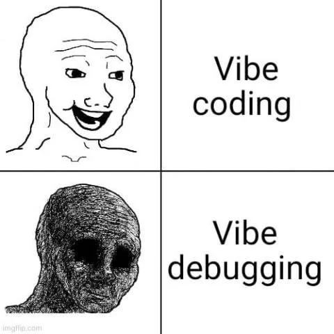
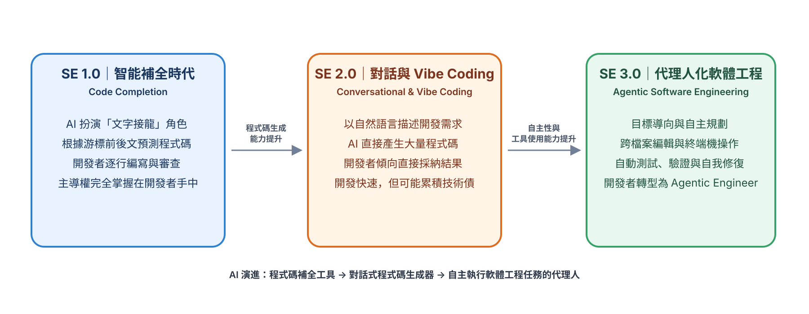
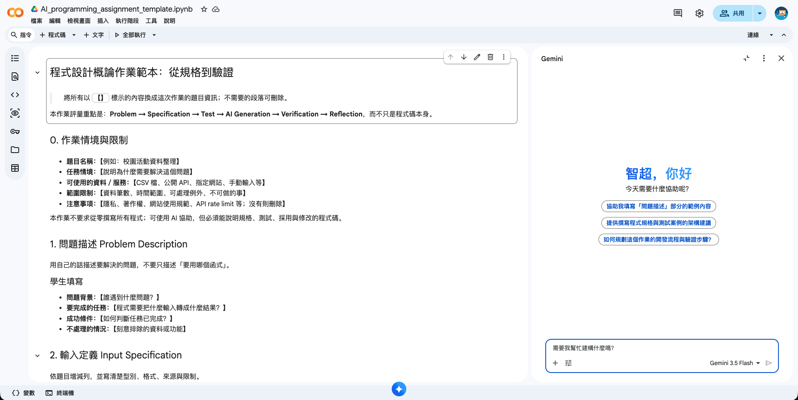
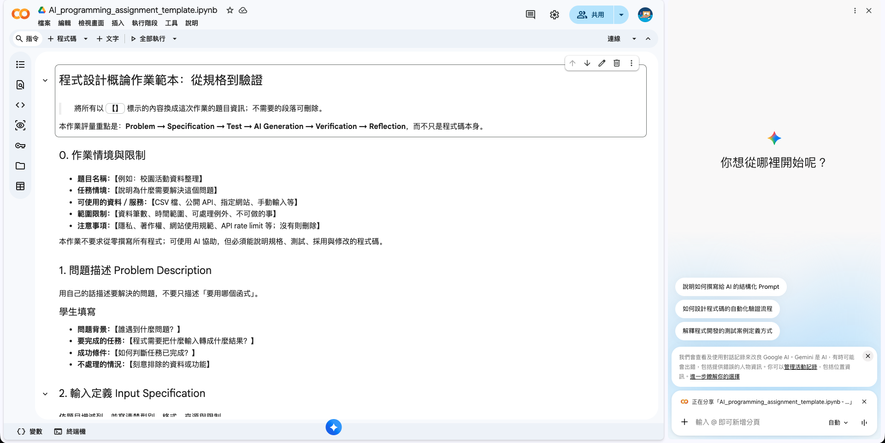

<!-- _class: cover -->

# AI Coding

許智超

cchsu@mail.nsysu.edu.tw

---

<!-- _class: section-page -->

## AI Coding

---

<!-- _class: lead -->

### AI 這麼厲害，我還要學 Coding 嗎？


---

<!-- _class: lead -->

### 我是不是可以 Vibe Coding 就好？



---

### Vibe Coding 的隱憂

- **看起來能跑，不代表正確**：沒有驗證，錯誤藏在邊界情況
- **看不懂、改不動**：程式碼不是自己的，出錯無從除錯
- **越改越亂**：對話一長，AI 忘記前面的決定，改一處壞三處
- **安全與品質風險**：金鑰外洩、漏洞、相依套件問題難以察覺
- **無法重現與維護**：同樣的 Prompt 得到不同結果，意圖沒有記錄

> 適合：原型、一次性小工具　不適合：要長期維護的系統

---

### 用軟體工程解決 Vibe Coding 的問題

| Vibe Coding 的隱憂 | 軟體工程的解法 |
|---|---|
| 看起來能跑，不代表正確 | **測試**：TDD、自動化測試 |
| 看不懂、改不動 | **程式碼審查**、模組化、文件 |
| 越改越亂 | **版本控制**（Git）、小步提交 |
| 安全與品質風險 | 安全檢查、相依套件掃描、CI |
| 無法重現與維護 | **規格先行**：SDD、BDD |

> AI 負責寫得快，軟體工程負責做得對

---

### 軟體工程（SE）與 AI 結合的演進階段



---

### SDD：Spec-Driven Development

- 先寫**規格**，再讓 AI 實作
- 規格 = 需求 + 限制 + 驗收標準
- 人定義「做什麼」，AI 負責「怎麼做」

---

### SDD 的流程

1. **Specify**：描述要做什麼、為什麼做
2. **Plan**：決定技術選型與架構
3. **Tasks**：拆成小而可驗證的任務
4. **Implement**：AI 實作，人審查

---

### 為什麼 AI Coding 需要 SDD？

| Vibe Coding 的問題 | SDD 的解法 |
|---|---|
| Prompt 含糊，AI 只能猜 | 規格明確 |
| 對話一長，AI 忘記決定 | 規格存成檔案，隨時重載 |
| 改一處壞三處 | 驗收標準可驗證 |
| 結果不一致、難維護 | 意圖有文件、可追溯 |

> AI 寫得很快，瓶頸變成「說清楚要什麼」

---

### BDD：Behavior-Driven Development

- 用**行為**描述需求，再驅動開發與測試
- 用 Given / When / Then 寫成人人看得懂的情境
- 同一份情境，既是需求，也是自動化測試

---

### BDD 的流程：Discover → Formulate → Automate

1. **Discover**：和使用者、團隊討論，找出具體範例
2. **Formulate**：把範例寫成 Given / When / Then
3. **Automate**：情境變成自動化測試，AI 負責讓它通過

工具：Cucumber、Behave、pytest-bdd

---

### 為什麼 AI Coding 需要 BDD？

| AI Coding 的問題 | BDD 的解法 |
|---|---|
| 需求用自然語言，AI 誤解 | 具體情境，沒有模糊空間 |
| 人看不懂測試程式碼 | 情境用白話寫，人可直接審查 |
| 需求和測試脫節 | 情境本身就是可執行的測試 |
| AI 自己宣稱「完成了」 | 情境通過才算完成 |

> SDD 管「做什麼」，BDD 把它寫成行為，TDD 管「做對沒」

---

### 行為怎麼寫？Given / When / Then

- **Given**：前提，目前的狀態
- **When**：當發生什麼動作
- **Then**：預期的結果

```gherkin
Given 使用者已登入，購物車有 2 件商品
When  使用者按下「結帳」
Then  顯示訂單總額，並建立一筆待付款訂單
```

一條需求 = 一個可驗證的情境，也能直接轉成測試

---

### TDD：Test-Driven Development

- 先寫**測試**，再寫程式
- 測試 = 可執行的規格
- 人定義「什麼叫做對」，AI 負責讓測試通過

---

### TDD 的流程：Red → Green → Refactor

1. **Red**：先寫一個會失敗的測試
2. **Green**：寫最少的程式讓測試通過
3. **Refactor**：在測試保護下重構

重複循環，每次只前進一小步

---

### 為什麼 AI Coding 需要 TDD？

| AI Coding 的問題 | TDD 的解法 |
|---|---|
| AI 看起來對，其實有錯 | 測試客觀判定對錯 |
| 看不懂每一行程式碼 | 只需審查測試與結果 |
| 改一處壞三處 | 回歸測試立即發現 |
| AI 自己宣稱「完成了」 | 測試通過才算完成 |

> SDD 管「做什麼」，BDD 寫成行為，TDD 管「做對沒」

---

<!-- _class: lead -->

### 測試案例，是 AI Coding 最重要的一份文件

**沒有測試案例，你就無法判斷 AI 寫的程式是否正確**

---

### 如何撰寫好的測試案例

- **正常情況**：最常見、預期的輸入
- **邊界情況**：空資料、最小／最大值、只有一筆
- **異常情況**：缺欄位、格式錯誤、找不到資源
- **先寫測試，再請 AI 實作**，不要讓 AI 自己出題自己考
- 測試要**具體、可重現**：明確的輸入與預期結果

```python
def test_empty_input():
    assert process_data([]) == []   # 邊界：空資料
```

---

<!-- _class: section-page -->

## 作業說明

從規格到驗證

---

### 作業流程

**Problem → Specification → Test → AI Generation → Verification → Reflection**

- 重點不只是程式碼本身
- 你要能說明規格、測試、採用與修改的程式碼

範本：[AI_programming_assignment_template.ipynb](https://colab.research.google.com/drive/1jzG8wH-S57AD20cujgTfQgdrQfJUvVYY)

---

### 1. 作業情境與限制

- **題目名稱**：BMI 計算器
- **任務情境**：健康中心要批次計算學生的身體質量指數，並判斷體位
- **可使用的資料**：CSV 檔（姓名、身高 cm、體重 kg），或手動輸入
- **範圍限制**：最多 10 筆；只處理成人標準；不做飲食或醫療建議
- **注意事項**：資料含個人健康資訊，不可上傳公開網站

本作業不要求從零撰寫所有程式；可使用 AI 協助，但必須能說明規格、測試、採用與修改的程式碼

---

### 2. 問題描述 Problem Description

- **問題背景**：健康中心人工算 BMI 慢又容易出錯
- **要完成的任務**：輸入身高、體重，輸出 BMI 與體位分類
- **成功條件**：BMI 取到小數點後 1 位，分類符合標準；每筆資料都有結果或明確的錯誤原因
- **不處理的情況**：兒童青少年的 BMI 百分位、體脂率

BMI = 體重(kg) ÷ 身高(m)²

分類（國健署成人標準）：過輕 < 18.5　正常 18.5～<24　過重 24～<27　肥胖 ≥ 27

---

### 3. 輸入與輸出定義

| 輸入項目 | 範例值 | 型別 | 說明與限制 |
|---|---|---|---|
| `name` | `小明` | str | 不可為空 |
| `height_cm` | `170` | float | 100～250 |
| `weight_kg` | `65` | float | 20～300 |

| 輸出欄位 | 型別 | 說明 |
|---|---|---|
| `bmi` | float | 小數 1 位 |
| `category` | str | 過輕／正常／過重／肥胖 |

另外請輸出：成功筆數、略過筆數

---

### 4. 測試案例：Given / When / Then

在要求 AI 寫程式**前**，先定義「怎樣才算做對」

| 案例 | Given | When | Then |
|---|---|---|---|
| 正常輸入 | 身高 170、體重 65 | 計算 BMI | 22.5，正常 |
| 邊界情況 | BMI 剛好 24.0（身高 100、體重 24） | 分類 | 過重（不是正常） |
| 異常資料 | 身高 0 或體重為負、文字 | 計算 BMI | 略過並說明原因，不當掉 |
| 完整流程 | 含 5 筆的 CSV，其中 1 筆錯誤 | 執行 `main()` | 4 筆成功、1 筆略過 |

---

### 5. 給 AI 的規格 Prompt

```text
請使用 Python 與 pandas 撰寫 BMI 計算程式。
輸入為 CSV，欄位為 name, height_cm, weight_kg。
輸出 DataFrame，含 name, bmi（小數 1 位）, category。
分類：<18.5 過輕；18.5～<24 正常；24～<27 過重；>=27 肥胖。
拆成 load_data()、validate_data()、process_data()、
build_result()、main()。
身高需在 100～250、體重需在 20～300，否則略過並記錄原因。
不要自行增加未定義的功能。請附上對應測試案例 1～4 的程式碼。
```

---

### 6. 實作、執行與自動測試

- 把 AI 產生的程式貼入或修改（保留函式切分，讓每一段能獨立測試）
- 設定 `INPUT_SOURCE`、`MAX_RECORDS = 10`、`OUTPUT_FILE`
- 用 `run_tests()` 與 `assert` 驗證 Test Case 1～4

```python
assert calc_bmi(170, 65) == 22.5
assert classify(24.0) == "過重"      # 邊界值
```

> 不要只測試「程式沒有報錯」

---

### 7. 人工檢查

自動測試只能確認規則與格式，請抽查至少 3～5 筆結果

| 抽查項目 | 檢查結果／發現 |
|---|---|
| 用計算機驗算 BMI 是否一致 | 填寫 |
| 略過資料的原因是否合理 | 填寫 |
| 18.5、24、27 邊界的分類 | 填寫 |

選做：輸出 CSV，或畫出各體位的人數長條圖

---

### 8. 學生反思與 AI 使用紀錄

1. AI 第一次產生的 BMI 程式是否直接通過所有測試？失敗在哪裡？（例如邊界值 24 分到哪一類）
2. 你如何修改問題描述、輸入、輸出或測試案例，讓 AI 更清楚需求？
3. 哪些情況尚未被測試？（例如身高輸入成公尺、欄位名稱不同）
4. 程式最可能因哪些外部變化而失效？（例如 CSV 格式、分類標準更新）
5. 若有更多時間，你會如何改善？

**AI 使用紀錄**：給 AI 的主要 Prompt、採用的部分、自己修改的部分、修改原因

---

### 評分 Rubric

| 評分面向 | 比例 |
|---|---:|
| 問題描述清楚且範圍明確 | 15% |
| Input / Output 規格完整 | 15% |
| Test Cases 能反映需求 | 25% |
| 程式能完成任務並通過測試 | 25% |
| AI 使用、除錯與反思紀錄 | 20% |

---

### 在 Colab 中，我如何和 AI 協作？



---

### 在 Colab 中，我如何和 AI 協作？



---

<!-- _class: section-page -->

## Crawler with AI

---

### HW 爬取 PTT 電影版

---

### 1. 作業情境與限制

- **題目名稱**：爬取 PTT 電影版最新討論
- **任務情境**：想知道最近大家在 PTT 電影版討論什麼電影，但人工逐頁瀏覽、整理很花時間；請寫程式自動擷取最新文章，整理成表格方便快速瀏覽
- **可使用的資料**：PTT 電影版公開頁面 `https://www.ptt.cc/bbs/movie/index.html`
- **範圍限制**：只抓文章列表（標題、作者、日期、推文數、連結），最多 10 筆；不抓文章內文與推文內容；不需要登入
- **注意事項**：遵守網站使用規範；每次請求間隔至少 1 秒，避免短時間重複執行；只供課堂學習，不可轉載或商業使用

本作業不要求從零撰寫所有程式；可使用 AI 協助，但必須能說明規格、測試、採用與修改的程式碼


