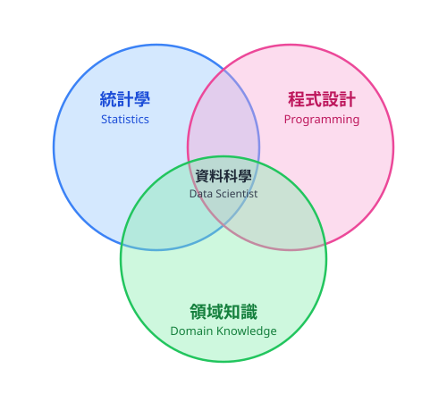

<!-- _class: lead -->
<!-- _paginate: false -->
<!-- _footer: "" -->

# 程式設計概論
# Data Analysis with AI
許智超
<cchsu@mail.nsysu.edu.tw>

---
<!-- _class: lead -->

## 什麼是資料科學？

---

### 資料科學的定義

> 一門結合**統計學**、**程式設計**與**領域知識**，
> 從資料中萃取有意義洞見的跨領域學科。

- 資料科學 ≠ 單純的程式設計
- 資料科學 ≠ 單純的統計分析
- 資料科學 ＝ 兩者的整合，加上對問題的深度理解

核心問題：**「資料能告訴我們什麼？」**
核心目標：**將洞察轉化為解決現實問題的決策行動**

---

<!-- _class: pattern -->

<div>

### 資料科學家的三大核心能力

- **統計學**：理解資料分佈、相關性與顯著性
- **程式設計**：資料處理、自動化與建模實作
- **領域知識**：定義有意義的問題，解讀分析結果

三者交集之處，即為資料科學家的核心定位。

</div>



---

### 資料科學的應用場景

- **醫療健康**：疾病預測、醫療影像輔助診斷
- **金融商業**：信用風險評估、詐騙偵測、個人化推薦
- **電子商務**：需求預測、客戶分群、A/B 測試
- **教育科技**：學習行為分析、適性化學習路徑規劃
- **社會科學**：輿情分析、政策影響評估

---


### InVisibleCities 台北消極空間活化/分析現狀

- 整合開放資料：人口密度、犯罪熱區、噪音舉報位置
- 以 QGIS 疊圖分析找出低活力、低可達性的閒置空間
- 將「哪裡需要改善」從主觀判斷轉化為可視化的空間證據

> 資料 → 洞察 → 行動


---

### 都市熱島效應預測/預測未來

- 結合衛星熱像、氣象資料與機器學習模型
- 預測高溫風險區域的空間分布與季節變化
- 協助規劃者決定綠化優先區域與降溫基礎設施配置

> 資料 → 洞察 → 預測 → 行動

</div>


---
<!-- _class: lead -->

## 如何進行資料分析？

---

<style scoped>
section p { text-align: center; font-size: 0.8em; }
</style>

### 資料分析的五大步驟


每個步驟皆有對應的 Python 工具，且步驟之間常需**反覆迭代**，而非單向線性流程。

---

### 步驟一：問題定義

分析的方向由問題決定，清楚的定義是一切的起點。

- **目的**：描述現況 / 預測趨勢 / 支援決策？
- **目標變數**：要分析或預測的核心欄位是什麼？
- **限制條件**：資料可取得性、時間成本、隱私規範

> 提出正確的問題，比找到漂亮的答案更重要。

---

<style scoped>
table th, td { font-size: 0.8em; }
</style>

### 步驟二：資料收集

| 來源類型 | 特性 | 範例 |
| :--- | :--- | :--- |
| 資料庫 | 結構化，整齊、有欄位定義 | CSV、SQL 資料庫 |
| 網路爬蟲 | 非結構化、需清理 | 新聞、社群貼文 |
| 公開資料集 | 現成、品質參差 | 政府資料開放平台 |
| API 串接 | 即時、有使用限制 | 氣象、社群媒體資料 |

---

<style scoped>
section li { font-size: 0.78em; }
</style>

### 公開資料集（一）

- [台灣政府資料開放平台](https://data.gov.tw/)
- [中華民國統計資訊網](https://www.stat.gov.tw/default.aspx)
- [Open Data Inception](https://opendatainception.io/)
    全球 2600 多個開放數據門戶，可按地圖查找各國開放資料。
- [世界經濟合作暨發展組織（OECD）](https://data.oecd.org/)
    可依國家與主題搜索人口、稅收、進出口等經濟資料。
- [World Bank Open Data](https://data.worldbank.org/)
    涵蓋全球各國氣候、融資、經濟、教育、人口等數據。

---

<style scoped>
section li { font-size: 0.78em; }
</style>

### 公開資料集（二）

- [UC Irvine Machine Learning Repository](https://archive.ics.uci.edu/)
    廣泛用於機器學習演算法實驗，提供多種標準資料集，適合學習與研究。
- [Kaggle](https://www.kaggle.com/)
    資料科學與機器學習線上社群平台，提供資料集、競賽與教學課程。
- [GitHub Awesome Public Datasets](https://github.com/awesomedata/awesome-public-datasets)
    高品質開放資料集列表，涵蓋多個主題領域。

---

<style scoped>
table th, td { font-size: 0.8em; }
</style>

### 步驟三：資料清理 — 常見品質問題

真實資料幾乎都有品質問題，清理是分析前的必要程序。

| 問題類型 | 說明 | 範例 |
| :--- | :--- | :--- |
| **缺失值** | 欄位為空（NaN） | 問卷未填答、感測器斷線 |
| **重複資料** | 同筆紀錄出現多次 | 系統重複寫入、資料合併錯誤 |
| **型別錯誤** | 資料型別不符預期 | 日期存為字串、數字夾雜文字 |
| **異常值** | 數值明顯偏離合理範圍 | 年齡輸入 999、負數金額 |
| **格式不一致** | 同義資料以不同格式儲存 | 「台北」vs「台北市」vs「Taipei」 |

---

<style scoped>
pre { font-size: 0.7em; }
section li { font-size: 0.82em; }
</style>

### 步驟三：缺失值處理

缺失值的處理策略取決於**缺失比例**與**欄位重要性**。

```python
import pandas as pd

df = pd.read_csv('data.csv')

df.isnull().sum()                          # 各欄位缺失數量
df.isnull().mean() * 100                   # 各欄位缺失比例（%）

df.dropna()                                # 刪除含缺失值的列（缺失少時適用）
df.dropna(subset=['age', 'income'])        # 僅針對關鍵欄位刪除
df['age'].fillna(df['age'].mean())         # 數值欄位：以平均值填補
df['age'].fillna(df['age'].median())       # 數值欄位：以中位數填補（較耐異常值）
df['city'].fillna(df['city'].mode()[0])    # 類別欄位：以眾數填補
df.ffill()                                 # 時間序列：以前一筆填補
```

- 缺失比例 > 40%：考慮**捨棄該欄位**
- 缺失有規律（非隨機）時，需特別留意填補方式對分析的影響

---

<style scoped>
pre { font-size: 0.7em; }
section li { font-size: 0.82em; }
</style>

### 步驟三：重複值、型別轉換與格式標準化

```python
# 重複值
df.duplicated().sum()                           # 計算重複列數
df.drop_duplicates()                            # 移除完全重複的列
df.drop_duplicates(subset=['id'])               # 依特定欄位去重（保留第一筆）

# 型別轉換
df['date'] = pd.to_datetime(df['date'])         # 字串 → 日期
df['price'] = df['price'].astype(float)         # 字串 → 數值
df['grade'] = df['grade'].astype('category')    # 字串 → 類別型（節省記憶體）

# 格式標準化
df['city'] = df['city'].str.strip()             # 移除前後空白
df['city'] = df['city'].str.replace('台北市', '台北')  # 統一寫法
df.columns = df.columns.str.lower().str.strip() # 欄位名稱標準化
```

---

<style scoped>
pre { font-size: 0.7em; }
section li { font-size: 0.82em; }
</style>

### 步驟三：異常值偵測與處理

```python
import numpy as np

# 方法一：描述統計目視判斷
df['age'].describe()

# 方法二：IQR（四分位距）法
Q1 = df['age'].quantile(0.25)
Q3 = df['age'].quantile(0.75)
IQR = Q3 - Q1
lower, upper = Q1 - 1.5 * IQR, Q3 + 1.5 * IQR
df_clean = df[df['age'].between(lower, upper)]  # 保留合理範圍

# 方法三：Z-score 法
from scipy import stats
z_scores = stats.zscore(df['age'].dropna())
df_clean = df[(abs(z_scores) < 3)]              # 保留 3σ 以內
```

- **刪除**：異常值為資料錯誤（如年齡 = 999）
- **截斷（Winsorizing）**：將極端值替換為上下界，保留樣本數
- **保留並標記**：異常值本身具有分析意義時（如詐騙偵測）

---

<style scoped>
table th, td { font-size: 0.82em; }
</style>

### 步驟四：探索分析（EDA）— 統計描述

建模前先「認識」資料的形狀與特性。

`df.describe()` 自動計算：

| 指標 | 說明 |
| --- | --- |
| count | 非空值筆數 |
| mean | 平均數 |
| std | 標準差（資料離散程度） |
| min / max | 最小值 / 最大值 |
| 25% / 50% / 75% | 四分位數（50% 即中位數） |

重點關注：**分布是否對稱？有無極端值？欄位間是否有線性關係？**

---

<style scoped>
pre { font-size: 0.72em; }
</style>

### 步驟四：統計描述 — 程式碼

```python
df.describe()                  # 數值欄位統計摘要
df['category'].value_counts()  # 類別欄位頻率分布
df.corr()                      # 各欄位相關係數矩陣（-1 到 +1）
df.isnull().sum()              # 各欄位空值數量
```

---

<style scoped>
table th, td { font-size: 0.82em; }
</style>

### 步驟四：視覺化呈現

用圖形將資料的模式轉為視覺訊號，讓洞見更易於理解與溝通。

| 圖表 | 用途 |
| --- | --- |
| 直方圖 | 看單一變數的分布（偏態、峰態） |
| 散佈圖 | 看兩變數之間的關聯 |
| 折線圖 | 看數值隨時間的趨勢 |
| 箱形圖 | 看分布範圍與離群值 |
| 熱力圖 | 看多欄位相關係數矩陣 |

---

<style scoped>
pre { font-size: 0.72em; }
</style>

### 步驟四：視覺化呈現 — 程式碼

```python
import matplotlib.pyplot as plt
import seaborn as sns

sns.histplot(df['score'])                    # 直方圖：觀察分布形狀
sns.scatterplot(x='x', y='y', data=df)      # 散佈圖：觀察兩變數關係
sns.heatmap(df.corr(), annot=True)           # 熱力圖：一次看所有欄位相關性
plt.show()
```

---

<style scoped>
table th, td { font-size: 0.82em; }
</style>

### 步驟四：資料轉化（Transformation）

調整資料的尺度或形式，使其更適合後續建模。

| 方式 | 說明 | 適用情境 |
| --- | --- | --- |
| 對數轉換 | 壓縮數值範圍 | 資料嚴重右偏（長尾分布） |
| 標準化 | 均值 0、標準差 1 | 各欄位尺度差異大、線性模型 |
| 正規化 | 值域壓縮至 [0, 1] | 需要固定值域範圍 |
| 類別編碼 | 文字 → 數值 | 類別型欄位轉為模型可用的輸入 |

---

<style scoped>
pre { font-size: 0.72em; }
</style>

### 步驟四：資料轉化 — 程式碼

```python
import numpy as np
from sklearn.preprocessing import StandardScaler, MinMaxScaler

# 對數轉換：壓縮右偏分布（如收入、人口）
df['log_income'] = np.log1p(df['income'])

# 標準化：均值 0、標準差 1（適合線性模型）
scaler = StandardScaler()
df['score_scaled'] = scaler.fit_transform(df[['score']])

# 正規化：壓縮至 [0, 1] 區間
mms = MinMaxScaler()
df['score_norm'] = mms.fit_transform(df[['score']])

# 類別編碼：文字 → 數值（one-hot encoding）
df = pd.get_dummies(df, columns=['city'])
```

---

<style scoped>
pre { font-size: 0.72em; }
</style>

### 步驟五：建模與結果解讀

以機器學習模型從資料中學習規律，並做出預測或分群。

```python
from sklearn.model_selection import train_test_split
from sklearn.linear_model import LinearRegression

X_train, X_test, y_train, y_test = train_test_split(X, y, test_size=0.2)
model = LinearRegression()
model.fit(X_train, y_train)
print(f'R² = {model.score(X_test, y_test):.3f}')
```

分析結果需回扣**步驟一的問題定義**，才能產生可行動的洞見。

---

<style scoped>
table th, td { font-size: 0.82em; }
</style>

### Python 工具套件速查

| 套件 | 用途 | 對應步驟 |
| :--- | :--- | :---: |
| `pandas` | 資料讀取、清理、操作 | 3、4 |
| `numpy` | 數值運算、矩陣處理 | 3、4 |
| `matplotlib` | 基礎繪圖 | 4 |
| `seaborn` | 統計圖表（基於 matplotlib） | 4 |
| `scikit-learn` | 機器學習建模與評估 | 5 |

---

<style scoped>
table th, td { font-size: 0.8em; }
</style>

### 資料分析工具比較

| 需求情境 | 建議工具 |
| :--- | :--- |
| 商業數據分析 | Power BI、Tableau、Excel、Python |
| 大數據與機器學習 | Python、R、SAS |
| 科學計算與工程分析 | MATLAB、Python、Julia |
| 學術統計研究 | R、SPSS、SAS、Python |
| SQL 資料庫查詢 | SQL（MySQL、PostgreSQL） |

---
<!-- _class: lead -->

## Data Analysis with AI

---

### 任務目標

利用 AI 提示詞，對**文化部電影票房開放資料**進行完整資料分析，體驗以對話方式驅動分析流程。

- 資料來源：https://data.gov.tw/dataset/94224
- 分析工具：Python（pandas、matplotlib）+ AI 助理
- 核心問題：哪些電影最賣座？不同國別地區表現如何？票房趨勢為何？
- 學習重點：如何設計有效提示詞，讓 AI 協助你完成從讀取資料到產出報告的完整流程

---

<style scoped>
table th, td { font-size: 0.8em; }
</style>

### 有效提示詞的要素

| 要素 | 說明 | 範例 |
| :--- | :--- | :--- |
| **角色設定** | 告訴 AI 扮演的專業角色 | 「請扮演 Python 資料分析師」 |
| **脈絡說明** | 提供資料的背景資訊 | 「這是文化部的電影票房資料」 |
| **任務描述** | 明確說明要執行的工作 | 「請執行資料清洗步驟」 |
| **輸出指定** | 指定輸出格式或任務拆解 | 「包含：1. 缺失值 2. 型別轉換」 |

四個要素**不必全部具備**，但越完整的提示詞通常產出越準確。

---

### 分析工作流程：四個核心提示詞

透過持續對話，依序完成完整分析任務：

1. **載入資料** — 讀取 CSV 並預覽欄位結構
2. **資料清洗** — 處理型別問題與格式不一致
3. **建議分析方向** — 請 AI 根據欄位提出分析題目
4. **產出分析報告** — 根據執行結果生成文字摘要

每個提示詞**接續前一輪對話脈絡**，AI 保有完整的分析記憶。

---

### 預先準備：matplotlib 字體設定

- 為了讓圖表中的中文能正常顯示，請先下載並安裝適合的中文字體（例如：台北黑體），並在 matplotlib 中設定使用該字體。
```python
!wget -nv -O TaipeiSansTCBeta-Regular.ttf https://drive.google.com/uc?id=1eGAsTN1HBpJAkeVM57_C7ccp7hbgSz3_&export=download
import matplotlib
matplotlib.font_manager.fontManager.addfont('TaipeiSansTCBeta-Regular.ttf')
matplotlib.rc('font', family='Taipei Sans TC Beta')
```

---

### 提示詞一：載入資料

- 任務目標：讓 AI 協助你讀取 CSV 資料，並展示前幾筆紀錄確認資料結構。
- 提示詞：
```text
請扮演 Python 資料分析師。請撰寫一段代碼來讀取文化部開放資料的 CSV 檔案，並展示資料的前 5 筆紀錄，讓我確認資料結構。
網址：`https://opendata.culture.tw/...`
```

- 重點：**角色設定** + **具體資料來源** + **指定輸出**（顯示前 5 行）

---


### 提示詞二：資料清洗

- 任務目標：讓 AI 協助你檢查資料品質問題，並規劃清洗步驟。
- 提示詞：
```text
針對目前的 DataFrame，在進行任何清洗動作之前，請先對這份資料進行初步分析，並以繁體中文回答以下內容：
1. 基本概況：資料共有多少行（rows）與多少欄（columns）？各欄位的資料型態（dtypes）為何？
2. 資料型態問題：請列出哪些欄位的資料型態不符合預期，例如：數值欄位被讀為字串、數值欄位有「$」「,」或「元」符號，日期欄位格式不正確...。
3. 缺失值檢查：請列出各欄位中缺失值（Null/NaN）的數量與佔比，並標示出缺失最嚴重的欄位。
4. 異常偵測：請快速檢查是否有重複的資料列，以及數值欄位中是否有明顯極端異常的數值。
建議：基於以上觀察，你認為在後續清洗過程中，哪些欄位需要優先處理，理由為何？
```

---

### 提示詞三：資料清洗 — 具體步驟

- 任務目標：讓 AI 規劃一份資料清洗計畫，並在獲得同意後逐步執行。
- 提示詞：
```text
基於你剛剛發現的問題（例如：缺失值、型態錯誤、重複值），請為我規劃一份詳細的資料清洗計畫。
1. 請針對有問題的欄位，逐一提出你建議的清洗方法與理由（例如：該刪除還是補值？）。
2. 請先不要直接修改資料，把清洗計畫條列出來讓我確認。
3. 在我回覆『同意』之後，你再開始執行清洗。
4. 每完成一個清洗步驟，請回報執行結果（例如：已刪除 10 筆重複資料，已將「銷售金額」欄位轉為數值型態）。
```

- 注意事項：
    - 保留原始資料：在清洗時，可以要求 AI：「請不要直接覆蓋原欄位，清洗後的結果請幫我建立新欄位（例如：新增 age_cleaned 欄位），以便我對照。」
    - 確認資料量變化：清洗完後，一定要看 AI 回報的最終列數。如果原本有 10,000 筆，清洗完只剩 2,000 筆，代表某個刪除條件下得太重了，需要請 AI 倒退回上一步重來。

---

### 提示詞四：分析方向

- 任務目標：初步分析資料內容。
- 提示詞：
```text
統計摘要：針對數值型欄位，提供基本的統計描述（平均值、中位數、最大/最小值、標準差）。
```
```text
請針對這份資料進行以下分析，並生成對應的視覺化圖表：
1. 相關性矩陣：請計算數值欄位之間的相關係數，並繪製熱力圖，幫我標出關聯性最強的 3 組變數對。
2. 分佈狀況：請選擇 3 個最重要的數值欄位，繪製直方圖或箱型圖來觀察資料的分佈狀況與離群值。
```

- 趨勢分析：如果你的資料包含日期資訊，可以進行時間序列的 EDA 分析。
- 分群與細分：如果你想了解資料中的細分市場或群體特徵，可以進行資料的分類與細分探索。

---

### 提示詞五：分析方向 — AI 提出建議

- 任務目標：讓 AI 根據資料內容自動提出有意義的分析方向，幫你找到「下一步該分析什麼」的靈感。
- 提示詞：(目的導向型)
```text
這是一份關於 [描述資料內容，例如：這個星期的全國電影票房統計數據] 的資料。
我的目標是想要 [描述你的目標，例如：提升營收、找出學生學習困難的原因、優化資源配置]。
請根據我的目標，針對這份資料規劃一份 EDA 分析路徑：
1. 哪些欄位是我最需要關注的關鍵指標？
2. 為了達成目標，你建議我進行哪些關鍵的數據比較或視覺化分析？
3. 有沒有哪些統計角度或是隱藏的變數關係，是常被忽略但可能很重要的？
```

---

### 提示詞六：分析方向 — AI 產出的建議

- 提示詞：(任務通用型)
```text
這是一份關於 [描述資料內容] 的資料。
我目前對於這份資料能進行哪些深入分析（EDA）沒有具體頭緒。請你作為數據分析顧問，針對這份資料：
1. 提出 3-5 個值得探索的洞察方向（例如：趨勢分析、客戶分群、關聯性研究等）。
2. 說明為什麼這些分析方向對我來說是有價值的。
3. 如果我採用你的建議，請擬定一個簡單的分析步驟清單。
請先不要開始執行分析，等我看完你的建議並選擇後，我們再進行下一步。
```

```txext
在不進行任何深入計算前，請憑藉你對數據分析的經驗：
1. 指出這份資料看起來最『有趣』或『最值得深入研究』的 3 個角度。
2. 假設你是這份資料的擁有者，你會想要透過數據回答什麼問題？
3. 完成這些分析後，能對我的決策提供什麼幫助？
請以『數據偵探』的角度，為我揭示這份資料中可能隱藏的故事。
```

---

### 提示詞七：執行分析

- 任務目標：讓 AI 根據你選定的分析方向，分段執行分析任務，並用繁體中文解讀每個分析結果。
- 提示詞：
```text
我認為『[填入 AI 建議的第 1 個方向]』對我最重要。
請現在依照這兩個方向開始執行分析，請遵循以下規範：
1. 請產出相關統計數據與視覺化圖表，並針對結果進行解讀。
2. 圖表格式：圖表請使用適合該數據類型的表現方式（例如：時間序列用折線圖、分類比較用長條圖）。
3. 中文化：圖表的標題、軸標籤（Label）請使用繁體中文（請確保中文字體顯示正常）。
```
- 注意事項：
    - 分段執行：每完成一個分析方向，請先讓 AI 回報結果並解讀，再決定是否繼續下一個分析方向。
    - 圖表解讀：AI 不僅要產出圖表，還要用繁體中文說明圖表中顯示的趨勢、關聯或異常，幫助你理解數據背後的意義。

---

### 提示詞八：產出分析報告

- 任務目標：讓 AI 根據剛剛的分析結果，撰寫一份正式的分析報告。
- 提示詞：
```text
請你根據剛剛的資料內容、統計數據與視覺化發現，為我撰寫一份正式的分析報告。
請依照以下結構撰寫，並使用專業且客觀的語氣（繁體中文）：
1. 執行摘要：以簡潔的文字概述報告的核心發現與價值。
2. 資料概況：說明分析的資料來源、範圍與清洗後的品質狀況。
3. 關鍵洞察：請歸納出 3-5 個最具影響力的發現。每個洞察請包含：
    - 發現描述：具體發生了什麼現象？
    - 數據支撐：引用剛剛分析出來的關鍵數字或圖表趨勢。
    - 商業/研究意義：這代表了什麼？（對業務、決策或研究有何啟發？）
4. 建議與行動方針：基於上述發現，你建議我採取哪些具體的後續行動？
5. 限制與未來方向：簡單列出本次分析的侷限性，以及建議未來可以補強的數據或分析方向。
請確保報告重點突出，建議適當使用 Markdown 格式（如粗體、條列式）提升閱讀體驗。
```

---

### RP02 期末報告：以 AI 驅動資料分析

- 選擇一份政府公開資料集，設計一系列提示詞，讓 AI 協助你完成從資料清洗到分析報告的完整流程。
- 報告內容需包含：
    1. 資料集介紹：資料來源、內容概述、分析目的
    2. 提示詞設計：說明每個提示詞的目的與設計邏輯
    3. 分析結果展示：包含 AI 協助產出的統計數據、圖表與分析報告摘要
    4. 反思與心得：AI 在資料分析過程中的優勢與限制，以及你對未來 AI 驅動分析的看法

---

## 參考資料

- [Python for Data Analysis — Wes McKinney](https://wesmckinney.com/book/)
- [Kaggle Learn — pandas 教學課程](https://www.kaggle.com/learn/pandas)
- [Seaborn 官方文件](https://seaborn.pydata.org/)
- [scikit-learn 使用者指南](https://scikit-learn.org/stable/user_guide.html)
- [政府資料開放平台](https://data.gov.tw/)
